# ShopKart

Full-stack MERN commerce app built across Engineering Labs 01-06:
authentication, product catalogue, wishlist, cart with global state, and
checkout with Razorpay Test Mode payments and order history.

## Screenshots

All screenshots are from the running app: real data from MongoDB Atlas and a real
Razorpay Test Mode payment.

### Authentication

| Login | Register |
|-------|----------|
| 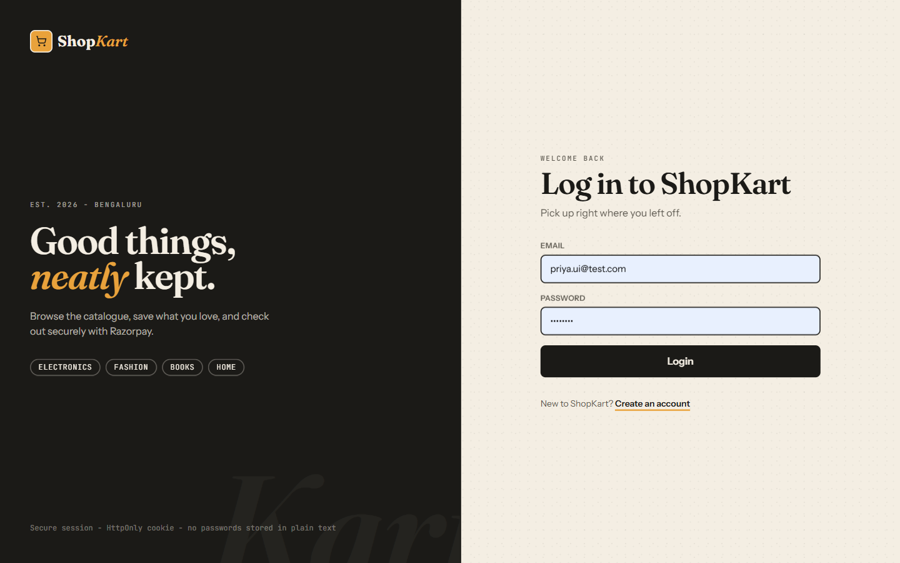 | 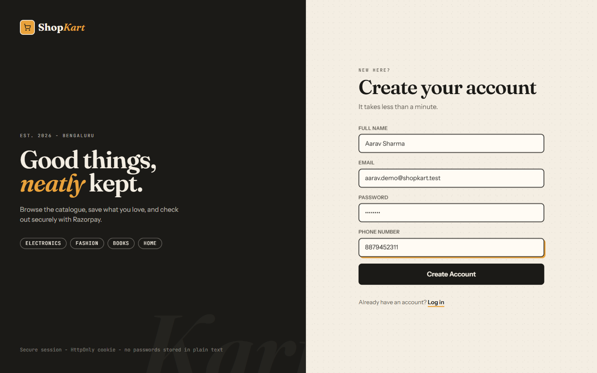 |

### Home

Profile loaded from `GET /customers/me`, live cart and wishlist counts, and change password.

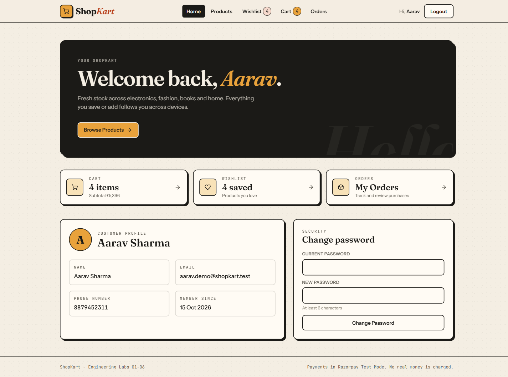

### Product catalogue

| All products | Search, category filter and sort |
|--------------|----------------------------------|
| 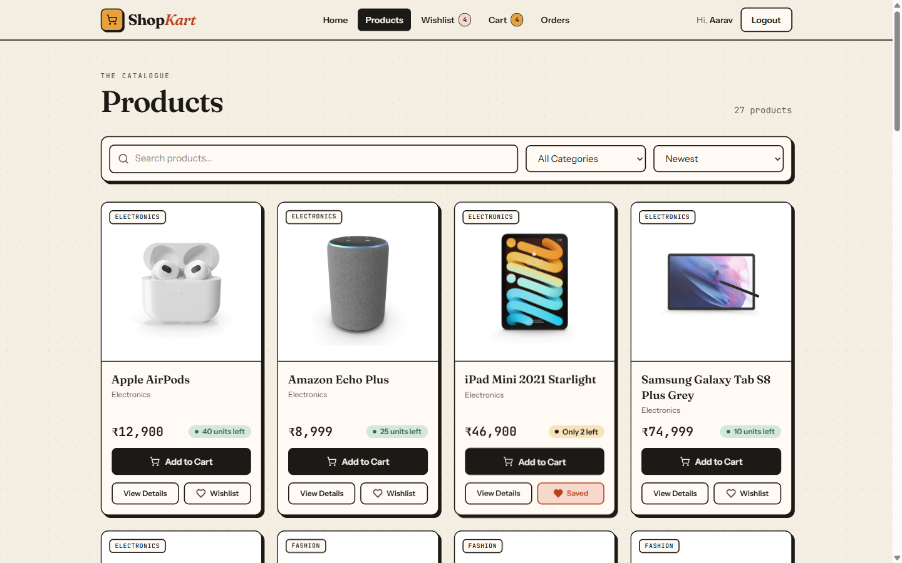 | 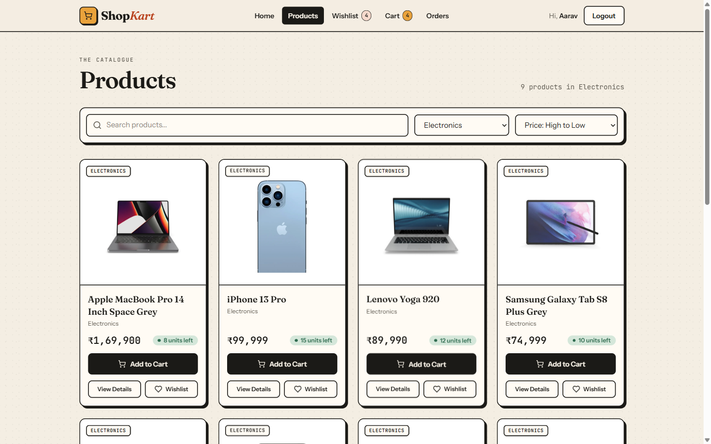 |

| Product details | Wishlist |
|-----------------|----------|
| 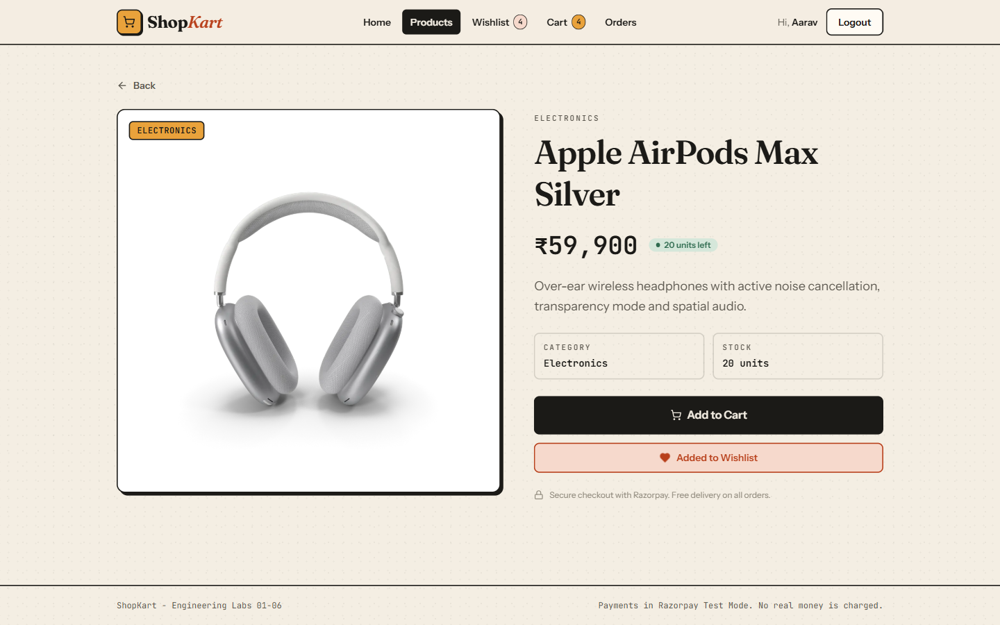 | 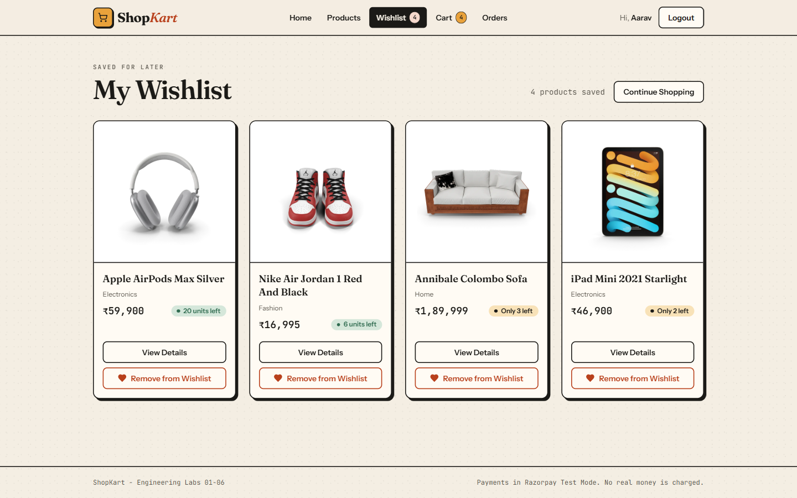 |

### Cart and checkout

| Cart (global state, derived totals) | Checkout with shipping form |
|-------------------------------------|-----------------------------|
| 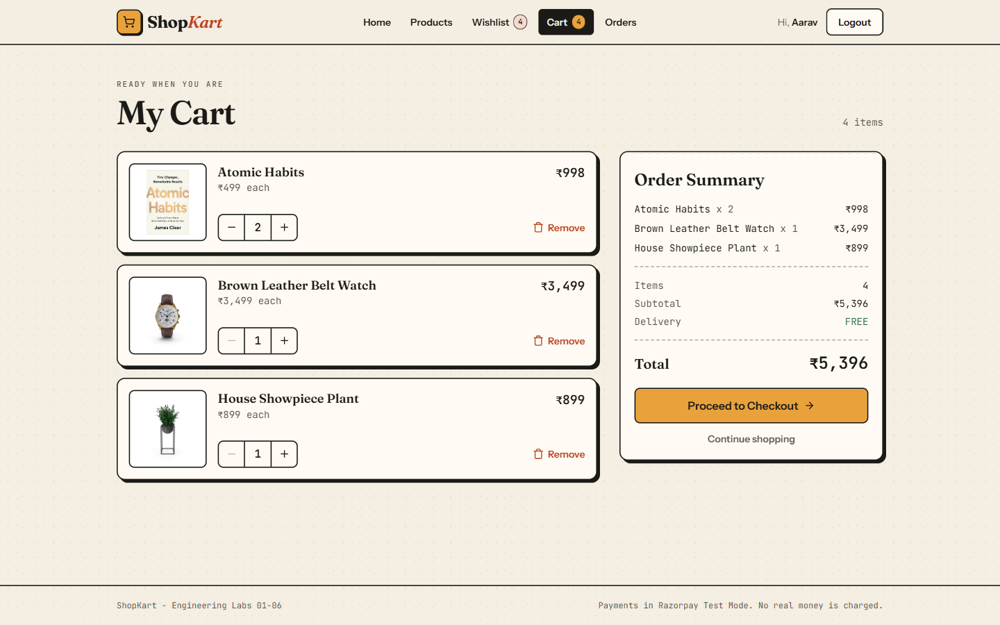 | 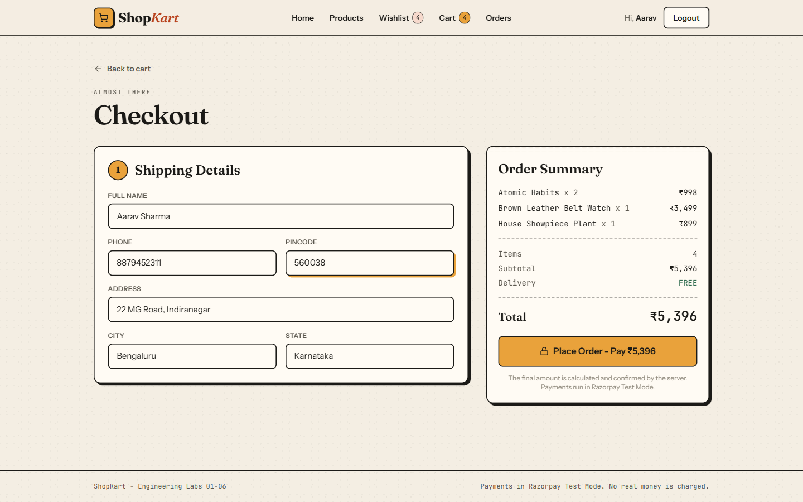 |

| Razorpay Test Mode checkout | Order placed after server-side signature verification |
|-----------------------------|-------------------------------------------------------|
| 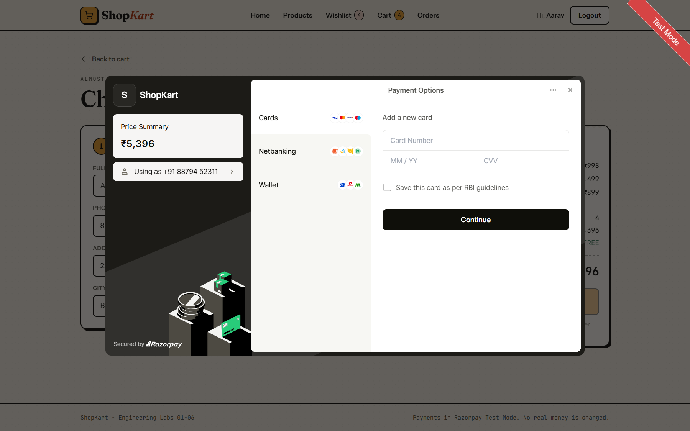 | 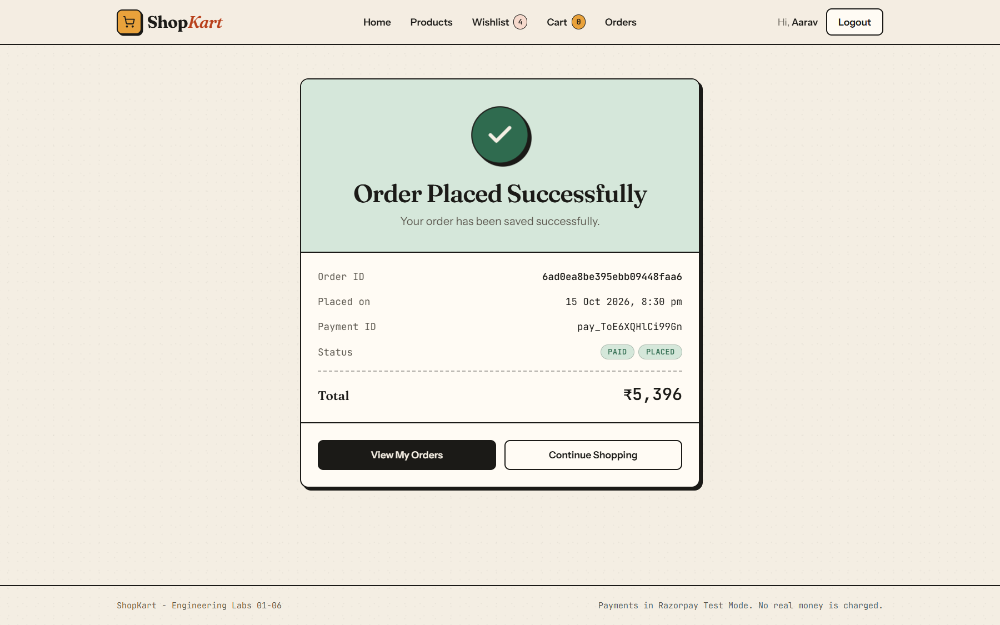 |

### Orders

| My Orders | Order details (status tracker, price snapshot) |
|-----------|-----------------------------------------------|
| 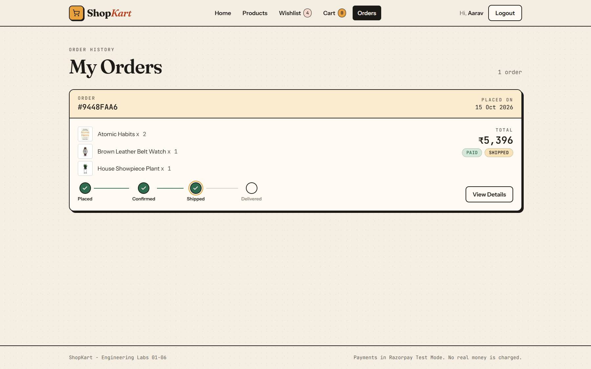 | 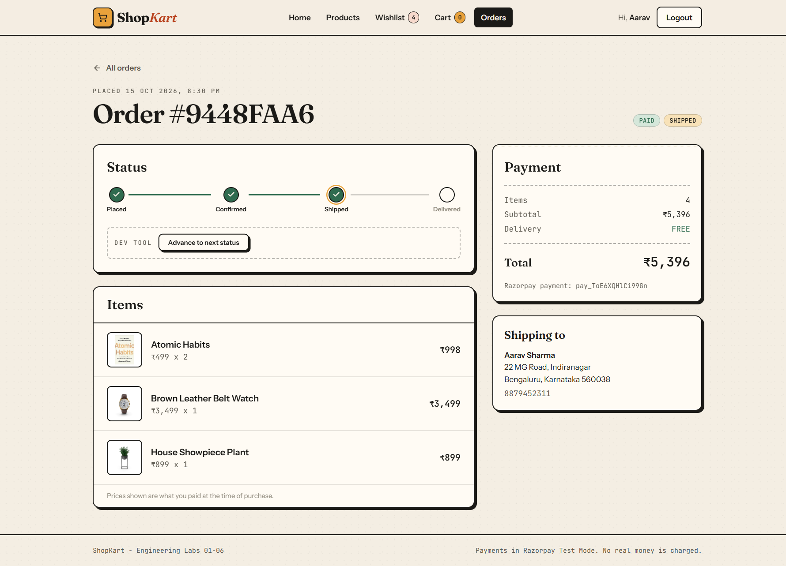 |

### Mobile

| Products | Orders |
|----------|--------|
| 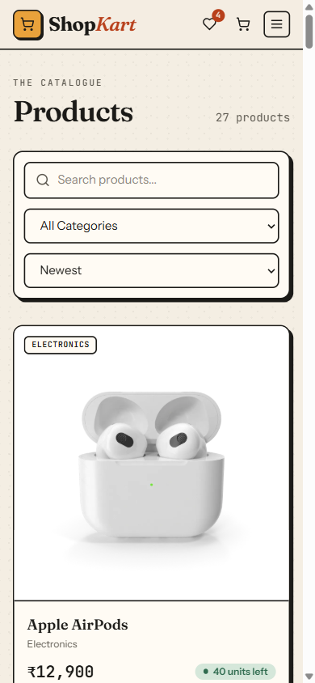 | 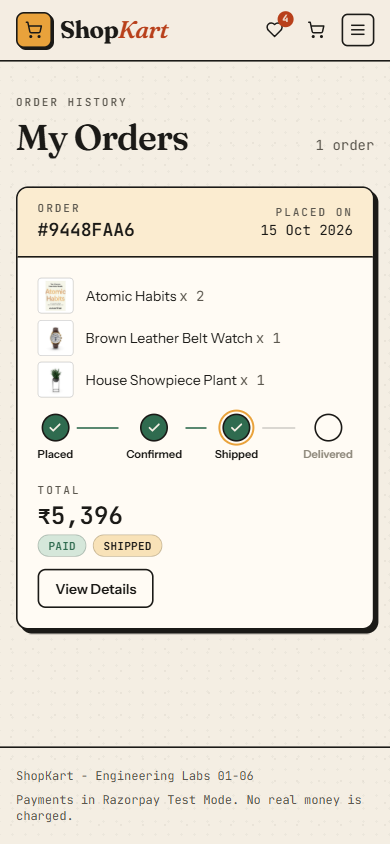 |

## Stack

| Layer    | Tech |
|----------|------|
| Backend  | Node.js, Express 5, MongoDB, Mongoose, bcrypt, jsonwebtoken, cookie-parser, razorpay |
| Frontend | React 19, React Router 7, Axios, Tailwind CSS 4, Vite |
| Auth     | JWT stored in an HttpOnly cookie (also accepts `Authorization: Bearer` for Postman) |

## Getting started

### 1. Backend

```bash
cd backend
npm install
```

Create `backend/.env`:

```env
MONGODB_URI="mongodb+srv://<user>:<password>@<cluster>/"
jwt_secret="<long random string>"
PORT=8086
CLIENT_URL="http://localhost:5173"
DB_NAME="shopkart"

# Razorpay Test Mode keys: dashboard.razorpay.com -> Test Mode -> API Keys
RAZORPAY_KEY_ID=rzp_test_xxxxxxxxxxxx
RAZORPAY_KEY_SECRET=xxxxxxxxxxxxxxxx
```

If you use MongoDB Atlas, your current IP must be on the cluster's
Network Access list.

```bash
npm run seed      # inserts 27 sample products (use "npm run seed -- --reset" to reseed)
npm run dev       # http://localhost:8086
```

### 2. Frontend

```bash
cd frontend
npm install
npm run dev       # http://localhost:5173
```

The frontend talks to `http://localhost:8086` by default. Set `VITE_API_URL`
in `frontend/.env` to point it elsewhere.

### Test payments

Razorpay Test Mode only, so no real money moves.
- Card `4111 1111 1111 1111`, any future expiry, any CVV, then "Success" on the OTP page
- UPI `success@razorpay` (succeeds) or `failure@razorpay` (fails)

## API

| Method | Endpoint | Auth | Purpose |
|--------|----------|:----:|---------|
| POST   | `/customers/register` | | Register (bcrypt-hashed password) |
| POST   | `/customers/login` | | Login, sets HttpOnly cookie |
| GET    | `/customers/me` | yes | Current customer |
| POST   | `/customers/logout` | yes | Clear auth cookie |
| PATCH  | `/customers/change-password` | yes | Change password (bonus) |
| POST   | `/products` | | Create product |
| GET    | `/products?search=&category=&sort=` | | List with search, category filter, `price_asc` / `price_desc` sort |
| GET    | `/products/categories` | | Distinct categories |
| GET    | `/products/:id` | | Single product |
| GET    | `/wishlist` | yes | Populated wishlist |
| POST   | `/wishlist/:productId` | yes | Add (409 on duplicate) |
| DELETE | `/wishlist/:productId` | yes | Remove |
| PATCH  | `/wishlist/:productId/toggle` | yes | Toggle (bonus) |
| GET    | `/cart` | yes | Populated cart |
| POST   | `/cart/:productId` | yes | Add 1 / increment, stock-checked |
| PATCH  | `/cart/:productId` | yes | Set quantity `{ quantity }` |
| DELETE | `/cart/:productId` | yes | Remove item |
| GET    | `/orders/payment-config` | yes | Whether Razorpay is configured (never exposes the secret) |
| POST   | `/orders/create-payment-order` | yes | Validate cart + stock, server-side total, pending order + Razorpay order |
| POST   | `/orders/verify-payment` | yes | HMAC SHA256 signature check, mark PAID/PLACED, decrement stock, clear cart |
| POST   | `/orders/:id/payment-failed` | yes | Record a failed payment attempt |
| GET    | `/orders` | yes | My paid orders, newest first (`?include=all` for pending/failed too) |
| GET    | `/orders/:id` | yes | Single order (owner only, otherwise 404) |
| PATCH  | `/orders/:id/status` | yes | Dev-only: advance PLACED -> CONFIRMED -> SHIPPED -> DELIVERED (bonus) |

## Design notes

- The user id always comes from the verified JWT, never from the request body or URL.
- Wishlist and cart store Product references only, and price/stock are always read live.
- Orders snapshot name, price and image at purchase time, so later price changes
  don't rewrite history.
- The checkout request carries only the shipping address. Items, prices and the total
  are rebuilt on the server from the user's cart and the latest product data.
- The cart is cleared only after the Razorpay signature is verified on the server.
- Frontend cart state is a single React Context (`CartContext`) mirrored from the
  backend after every mutation. Subtotal and counts are derived, never stored.

## Project structure

```text
backend/
  config/        db + Razorpay client
  controllers/   customer, product, wishlist, cart, order
  middlewares/   auth (JWT from cookie or Bearer header)
  models/        User (wishlist + cart), Product, Order
  routes/
  utils/         token + cookie options, validators
  seed.js
frontend/src/
  context/       Auth, Cart (global cart state), Wishlist, Toast
  pages/         Login, Register, Home, Products, ProductDetails, Wishlist,
                 Cart, Checkout, OrderSuccess, Orders, OrderDetails
  components/    Navbar, ProductCard, SearchBar, CartItem, CheckoutForm,
                 OrderSummary, OrderCard, StatusTracker, ...
  services/api.js
```
